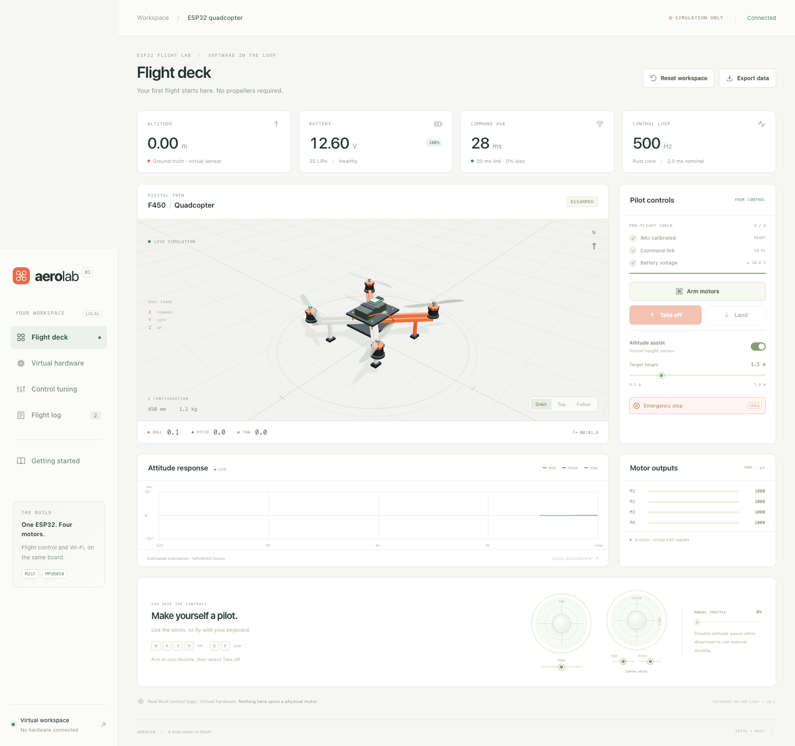
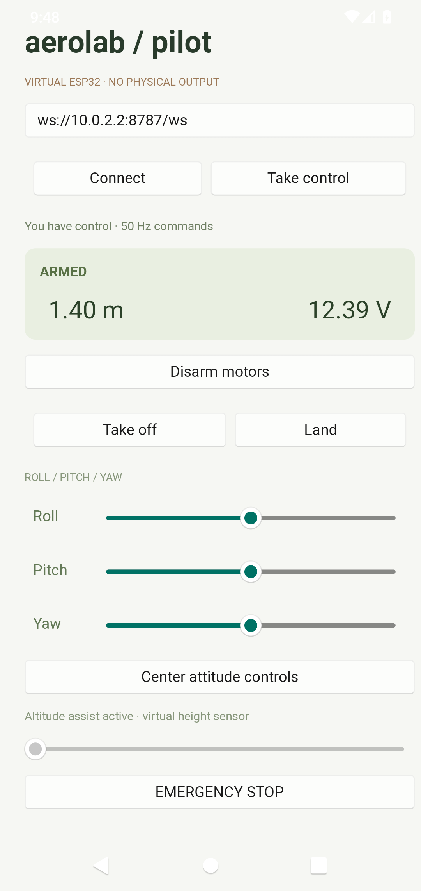

# ESP32 Rust Drone Simulator

[](https://github.com/sumerchoudhary78/esp32-rust-drone-simulator/actions/workflows/ci.yml)
[](LICENSE)

**Aerolab** is an open-source 3D quadcopter simulator for learning ESP32 drone
flight control in Rust. Experiment with MPU6050 sensor fusion, PID stabilization,
motor mixing and Wi-Fi failsafes before buying or connecting hardware.

Run the simulation on your computer and fly from a browser or the optional
Rust + Slint Android controller. No ESP32 board, Pixhawk, battery or motors are
required for the virtual setup.

**Current stage:** software-in-the-loop (SITL). The reusable Rust flight core
and virtual hardware run on the host. Flashable ESP32 firmware is a future
milestone; this project does not emulate the ESP32 CPU or qualify a real drone
for flight.



[Quickstart](#quickstart) · [Features](#what-is-implemented) ·
[Architecture](#architecture) · [Roadmap](ROADMAP.md) ·
[Contributing](CONTRIBUTING.md) ·
[Report a bug](https://github.com/sumerchoudhary78/esp32-rust-drone-simulator/issues/new/choose)

## Why use it?

- Learn how joystick inputs become attitude targets, body rates, PID corrections
  and four motor commands.
- Compare a noisy six-axis IMU estimate with the simulated drone's true motion.
- See what happens when commands expire, a sensor fails, voltage drops or a motor
  loses thrust.
- Change gains and link conditions, then inspect the response and export flight
  data for your own analysis.

The flight core is allocation-free `no_std` Rust. The 3D view displays the
server's simulated state; flight dynamics and stabilization execute in Rust.

## Quickstart

Install stable Rust and Git, then run:

```sh
git clone https://github.com/sumerchoudhary78/esp32-rust-drone-simulator.git
cd esp32-rust-drone-simulator
cargo run --release --locked
```

Open **http://127.0.0.1:8787**. Rust downloads its dependencies on the first build.
The browser assets, including Three.js, are bundled in the executable: there
are no runtime CDNs, Node servers, accounts or cloud services.
Node.js 22+ is needed only for development checks or refreshing browser
dependencies. The simulator itself needs only the Rust build.

1. Wait for the three preflight checks to turn green (~1 second).
2. Select **Arm motors**, then **Take off**. The virtual height helper climbs to
   1.5 m; change the target slider to fly at 0.5–5 m.
3. Use the touch sticks or **WASD** for tilt, **Q/E** for yaw. Commands return to
   level when released; horizontal motion can continue because there is no
   position hold.
4. Apply a disturbance and watch the attitude plot and motor mixing.
5. Select **Land** for assisted descent and automatic disarm.
6. Try the link, IMU, battery and front-left motor faults in **Control tuning**.
   Clear the fault, then explicitly acknowledge/disarm before rearming.

**Space** or **Emergency stop** cuts the virtual motor commands. Closing the
controller, losing commands or hiding its tab expires the 500 ms watchdog.
After returning to a hidden tab, select **Resume controls · disarm motors**.
Export data downloads up to the latest 6,000 browser-captured snapshots as CSV.

## Phone / Android

For a phone on the same trusted Wi-Fi as your computer:

```sh
cargo run --release -- --bind 0.0.0.0:8787
```

Open `http://YOUR_COMPUTER_LAN_IP:8787/controller` in the phone's browser. On
macOS, `ipconfig getifaddr en0` usually shows the Wi-Fi address. If another
browser owns the controls, **Take control** transfers ownership and disarms.
The default localhost binding is private to this computer; the optional LAN
binding has no authentication and is intended only for a trusted development
network. This protocol is not suitable for a physical aircraft.

A separate **Rust + Slint** native controller is in [`apps/controller`](apps/controller).
It uses the same WebSocket messages and supports desktop and Android targets:

```sh
cargo run --manifest-path apps/controller/Cargo.toml
```

Select **Connect**, then **Take control** if needed. An Android emulator reaches
the host at `ws://10.0.2.2:8787/ws`; a physical phone uses the host LAN address.
Android lifecycle pause/focus-loss stops command transmission. Native UI
dependencies are isolated so the simulator does not require Slint or an NDK.
See [`apps/controller/README.md`](apps/controller/README.md) for APK builds.



## What is implemented

| Layer       | Behavior                                                                                                                                                                 |
| ----------- | ------------------------------------------------------------------------------------------------------------------------------------------------------------------------ |
| Flight core | Allocation-free `no_std` Rust; fixed 2 ms step                                                                                                                           |
| IMU         | Specific force, gyro bias/noise, ±2 g / ±250°/s quantization; real 14-byte MPU6050 register decoder                                                                      |
| Attitude    | Quaternion gyro integration, near-1g accelerometer correction, stationary gyro-bias calibration                                                                          |
| Control     | Angle-to-rate outer loop, filtered rate PID, integral bounds, X mixer and bounded 1000–2000 µs outputs                                                                   |
| Plant       | 1.2 kg, 450 mm X frame, 6-DOF rotation/translation, thrust ∝ command², 45 ms motor lag, drag, simplified floor and battery sag/depletion                                 |
| Link        | 50 Hz commands, sequence validation, configurable 0–800 ms latency, 0–100% loss; 25 Hz telemetry                                                                         |
| Safety      | Zero-throttle/level/voltage arm gates; latched motor cut for 500 ms command expiry, IMU failure, critical voltage, >70° tilt, host scheduling overrun and emergency stop |
| Flight deck | Interactive 3D orbit/top/follow, touch/keyboard controls, attitude plot, ESC bars, hardware map, PID/environment settings, 40-event log, CSV export                      |
| Ownership   | One controller and any observers; takeover disarms; invalid or replayed commands never refresh the watchdog                                                              |

## Architecture

```text
Browser / Rust+Slint controller         Network task (host)
 normalized commands @ 50 Hz ───────► validate JSON → bounded input queue
         ▲                                      │
         │ telemetry @ 25 Hz                    ▼
         │                          Dedicated flight OS thread
         │                          simulated delay/loss → command
         │                          MPU6050 bytes → decode → fusion
         │                          safety → rate PID → X mixer
         │                          ESC lag → motors → 6-DOF plant
         └──────────────────────── latest immutable snapshot
```

The flight thread does no socket I/O and never waits for network consumers.
It drains bounded work using a bounded queue and publishes snapshots through
`watch::send_replace`. JSON snapshot serialization runs on this **host
simulator** thread; this is not a hard-real-time scheduler or an ESP32 timing
benchmark. A >100 ms host scheduling delay cuts armed virtual outputs.

```text
crates/flight-core/src/
  commands.rs    normalized inputs and validation
  imu.rs         MPU6050 register decoder
  attitude.rs    quaternion complementary filter
  pid.rs         filtered derivative, bounded integration
  motors.rs      X mixer and ESC pulse representation
  safety.rs      states, thresholds and stop reasons
  lib.rs         calibration, arming and control loop
crates/simulator/src/
  physics.rs     plant and noisy register-level IMU model
  lib.rs         link model, assistance, faults and telemetry
  server.rs      Axum HTTP/WebSocket; separate flight thread
web/             offline 3D cockpit and phone controls
apps/controller/ optional native Rust/Slint desktop/Android UI
tests/           live protocol and browser integration tests
docs/            protocol, OpenAPI and hardware-port boundary
postman/         reusable read-only checks
```

## Verification

```sh
cargo test --workspace
cargo clippy --workspace --all-targets -- -D warnings
cargo fmt --all -- --check
```

The Rust tests run deterministic plant scenarios without wall-clock sleeps.
They cover hover, an impulse, roll tracking, manual throttle, wind, landing,
faults, stale packets, loss/latency, ownership, timing stops and malformed input.
For the real server and browser checks:

```sh
npm ci
npm test
npm run test:browser
```

The protocol checks start a separate simulator on port 8791. Playwright starts
another on 8790 and uses installed Google Chrome. It checks the flight flow,
fault recovery, takeover, CSV, sticks and layouts at 320/390/768/1440 px.
The default interactive simulator remains on 8787. Screenshots go in `output/`.
To refresh vendored Three.js after intentionally changing its pinned version:
`npm run vendor`, then rebuild Rust. Three.js's MIT license is included with it.

With a simulator running, Postman checks the actual HTTP contract:

```sh
postman collection run postman/aerolab.postman_collection.json
```

See [`docs/protocol.md`](docs/protocol.md) and [`docs/openapi.json`](docs/openapi.json).
The public CI workflow runs Rust checks, the standalone core cross-check, and
HTTP/WebSocket/browser integration tests. Native Android verification is
recorded separately in [`docs/verification.md`](docs/verification.md).

## Roadmap

The next work should make experiments reproducible before moving the controller
onto physical hardware:

1. **Repeatable scenarios and replay:** seeded runs, saved inputs and numerical
   hover, tracking and recovery metrics.
2. **Better models and tuning tools:** configurable frames and motor curves,
   sensor vibration/saturation, and plots comparing truth with the estimator.
3. **ESP32 bench firmware:** one explicit board target, real MPU6050 reads,
   validated ESC outputs, independent motor inhibit and measured loop jitter.
4. **Hardware-in-the-loop:** exercise that firmware against the virtual plant
   with delay, sensor and watchdog faults.
5. **Measured altitude and recovery:** add suitable height sensing and validate
   an airborne failsafe policy before claiming autonomous safe landing.

See [ROADMAP.md](ROADMAP.md) for priorities, completion criteria and later ideas.
These are planned milestones, not features already implemented or promised dates.

## Contributing and getting help

Bug reports, documentation improvements, reproducible scenarios and controller
experiments are welcome. Start with [CONTRIBUTING.md](CONTRIBUTING.md); use
[GitHub Issues](https://github.com/sumerchoudhary78/esp32-rust-drone-simulator/issues)
for a reproducible problem or a focused proposal. Explain the behavior or metric
a change will improve, and keep simulation-only sensors clearly identified.

## Frequently asked questions

**Can I learn ESP32 drone control without hardware?** Yes. The Rust simulator
provides a virtual IMU, ESCs, motors and quadcopter so you can explore the control
loop and failures locally. The ESP32 hardware adapter is still planned.

**Does it replace Wokwi or emulate an ESP32 chip?** No. It is a flight-dynamics
and control-logic simulator, not an instruction-set or electrical emulator.

**Does the MPU6050 provide altitude hold or position hold?** No. Its six-axis
measurements support attitude estimation. The optional altitude helper uses
simulated ground-truth height and vertical speed. There is no GPS position hold.

**Can I flash this code and fly a real quadcopter?** Not yet. Read the
[hardware-port boundary](docs/esp32-port.md); physical drivers, timing, component
compatibility, independent inhibition and restrained validation remain open.

## Before hardware

This is **not ESP32 CPU, electrical, radio or ESC-firmware emulation**. It does
not flash an ESP32 or drive GPIO. Plant constants and gains are illustrative,
not measurements of the suggested A2212/10-inch/3S build.

The altitude helper uses simulated ground-truth height and vertical velocity.
An MPU6050 cannot supply those measurements. The six-axis filter also has no
absolute yaw reference, and sustained translational acceleration can bias its
tilt estimate. There is no GPS, obstacle sensing, navigation or position hold.

The defined failsafe is **motor cut**, so an airborne quad can fall. This lab
does not implement or promise an autonomous safe landing on link loss. The
assisted Land button is a simulation-only normal-flight helper.

See [`docs/esp32-port.md`](docs/esp32-port.md) for the future ESP32 adapter,
proposed pins, power boundaries and propellers-off validation requirements.

Official references used for the host and future platform adapters:
[Axum WebSockets](https://docs.rs/axum/0.8.9/axum/extract/ws/index.html),
[Rust on ESP hardware/toolchains](https://docs.espressif.com/projects/rust/book/introduction/hardware-overview.html),
[Slint Android](https://docs.slint.dev/latest/docs/rust/slint/android/).

## License

Project source is [MIT licensed](LICENSE). Third-party dependencies keep their
own licenses; Three.js's license is vendored with its source. Review Slint's
separate licensing options before redistributing native controller binaries.
